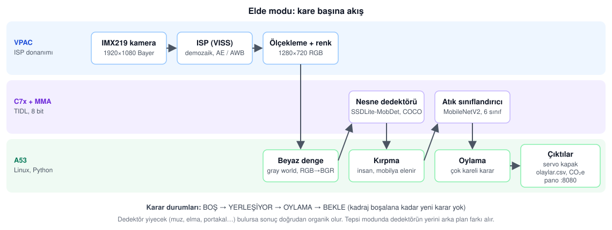
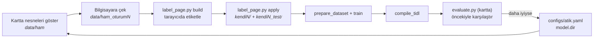
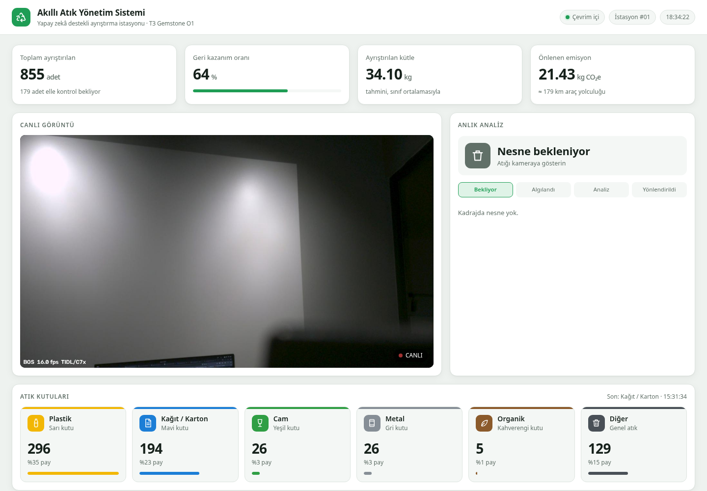

# T3 Gemstone O1 Atık Ayrıştırıcı

Raspberry Pi Camera v2 (IMX219) ile tepsiye konan atığı **plastik, organik,
kağıt/karton, cam, metal, diğer** olarak sınıflandırır. İsteğe bağlı bir
servo kapağı atığı doğru kutuya yönlendirir. Her karar kaydedilir ve doğru
ayrıştırmanın önlediği sera gazı **kg CO₂e** olarak tahmin edilip tarayıcı
panosunda gösterilir.

İklim değişikliği bağlantısı: depolama alanına giden organik atık metan
üretir, geri dönüşmeyen plastik/metal/cam yeniden üretim enerjisi ister.
Kaynağında doğru ayrıştırma ikisini de azaltır. Proje bu etkiyi sayarak
görünür kılar.

## Çalışma modları

`configs/atik.yaml` içindeki `mode` ayarı seçer:

| Mod | Ne zaman | Nasıl |
|---|---|---|
| **`elde`** (varsayılan) | Tanıtım; nesne kameraya elde gösterilir, arka plan ve kamera serbest | TI'ın COCO dedektörü (SSDLite-MobDet, C7x, ~16 ms) nesneyi bulur. İnsan, mobilya ve kadraj kenarından kesik kutular atlanır. Atık modeli yalnızca nesnenin kutusunu görür. Dedektör yiyecek derse (portakal, muz, elma…) sonuç doğrudan organik olur. |
| **`tepsi`** | Gerçek kutu; kamera sabit, atık hep aynı tepsiye konur | Boş tepsi öğrenilir, fark büyüyünce ROI sınıflandırılır. Aşağıdaki akış bu moda aittir. |

Elde modunda nesneyi gösterdikten sonra kadrajdan çıkarın. Sistem bir
sonrakine ancak o zaman geçer.

## Nasıl çalışır?



Görüntü A53'e ulaşmadan önce ISP donanımında (VPAC) işlenir. İki sinir ağı
da C7x üzerinde TIDL ile 8 bit çalışır. A53 yalnızca beyaz dengeyi, kırpmayı
ve karar mantığını yürütür.

1. **Nesneyi bulma.** Elde modunda COCO dedektörü kadrajdaki nesneyi bulur,
   insan ve mobilya gibi kutuları eler. Tepsi modunda boş tepsi öğrenilir ve
   fark büyüyünce "nesne var" denir. Sınıflandırıcıda "boş" sınıfı yoktur.
2. **Yerleşme.** Nesne görününce birkaç kare beklenir, görüntü otursun.
3. **Oylama.** Birden çok karenin çoğunluğu alınır. Güven ya da uyum düşükse
   karar `emin_degil` olur, kutuya yönlendirilmez.
4. **Bekleme.** Karar verildikten sonra kadraj boşalana kadar yeni karar
   verilmez. Aynı nesne iki kez sayılmaz.
5. **Kayıt.** `data/olaylar.csv` dosyasına zaman, sınıf, güven, tahmini kütle
   ve CO₂e yazılır. Uygulama yeniden başlayınca toplamlar buradan okunur.

## Veri ve model

Varsayılan veri kümesi [RealWaste](https://archive.ics.uci.edu/dataset/908/realwaste)'tir
(4.752 foto). Dokuz sınıfı altı kutuya eşlenir.

> [!WARNING]
> Lisans çelişkili: UCI sayfası CC BY 4.0 diyor, veri kümesinin kendi README'si
> **CC BY-NC-SA 4.0**. Kısıtlayıcı olanı esas alın: ticari kullanım yok, bu
> veriyle eğitilen model aynı lisansla paylaşılır.

Eşleme:

| Kutu | RealWaste sınıfları |
|---|---|
| plastik | Plastic |
| organik | Food Organics, Vegetation |
| kagit | Paper, Cardboard |
| cam | Glass |
| metal | Metal |
| diger | Miscellaneous Trash, Textile Trash |

Ek açık lisanslı kümeler (Hugging Face, giriş gerektirmez):

| Küme | Foto | Lisans | Kullanılan sınıflar |
|---|---|---|---|
| [Garbage Classification v2](https://huggingface.co/datasets/omasteam/waste-garbage-management-dataset) | 19.762 | MIT | biological, cardboard, clothes, glass, metal, paper, plastic, shoes, trash |
| [Recycling dataset](https://huggingface.co/datasets/viola77data/recycling-dataset) | 3.107 | Apache-2.0 | aluminium, cardboard, glass, hard/soft plastics, paper, polystyrene |

Bilerek dışarıda bırakılanlar: pil (tehlikeli atık, ayrı toplanır), kağıt
havlu (geri dönüşmez), takeaway bardak ve tek kullanımlık tabak (kağıt mı
plastik mi belli değil). `--cap 1500` tek klasörden en fazla 1500 foto alır,
böylece kıyafet ve ayakkabı "diğer"i ezmez.

`prepare_dataset.py` klasör adına bakarak eşler. Bu yüzden TrashNet ya da
Kaggle "Garbage Classification" gibi `<sınıf>/<foto>` yapısındaki başka
kümeler de `--src` ile eklenebilir. **En büyük kazanç kendi fotoğraflarınızdan
gelir.** Gerçek tepside IMX219 ile çekilen fotoğrafları `kendi/plastik/`,
`kendi/organik/` gibi klasörlere koyup `--src kendi` ile ekleyin.

### Eğitim (x86 bilgisayar, GPU önerilir)

```bash
cd training
pip install -r requirements.txt
curl -LO https://archive.ics.uci.edu/static/public/908/realwaste.zip && unzip -q realwaste.zip
python3 prepare_dataset.py --src realwaste-main/RealWaste --out dataset
python3 train.py --data dataset --out ../models/waste_mnv2 --epochs 20
```

Çıktı: `models/waste_mnv2/model.onnx` ve `labels.txt`. Ağ girdisi RGB 0–255
float, NCHW 1×3×224×224. Normalizasyon grafiğin içindedir.

İlk sonuçlar (MobileNetV2, 20 epoch, Quadro P4000):

| Model | Eğitim verisi | RealWaste dışı test | Plastik | Kartta (C7x, 8-bit, 90 foto) |
|---|---|---|---|---|
| v1 `waste_mnv2` | yalnız RealWaste | %52,3 | %21 | 38/90 |
| **v2 `waste_mnv2_v2`** | RealWaste + Garbage v2 + Recycling | **%93,8** | **%90** | **81/90** |

v1 RealWaste testinde %94 görünüyordu ama başka kaynaktan gelen fotoğraflarda
çöküyordu (çöp tesisi görüntülerine aşırı uyum). Canlı kamerada plastik
bardağa "kağıt" demesinin sebebi buydu. Kartta tahmin süresi 18,9 ms.

Açık veri kümeleri tek başına yetmedi: v2 canlı kamerada camı ve plastiği
karıştırıyordu. Sonraki modeller kendi kamera görüntülerimizle iyileştirildi
(aşağıdaki döngü).

### Kendi verisiyle iyileştirme döngüsü



1. **Toplama.** Uygulama, nesne kadrajdayken her `save_raw_every` (0,5 sn)
   saniyede bir kesiti `data/ham/<zaman>_<model tahmini>_<dedektör adı>.jpg`
   olarak kaydeder. Nesneleri 5–10 sn çevirerek gösterin. Arada 2 sn kadrajı
   boş bırakın, böylece her nesne ayrı bir grup olur.
2. **Bilgisayara alma.** Yeni kareleri bir oturum klasörüne kopyalayın:

   ```bash
   rsync -a gemstone@192.168.7.2:gem-waste-sorter/data/ham/ data/ham_oturum5/   # yalnızca yeni kareleri seçin
   ```

3. **Etiketleme.** Tek dosyalık bir sayfa üretilir, tarayıcıda açılır:

   ```bash
   cd training
   python3 label_page.py build --ham ../data/ham_oturum5 --out ../data/etiketle_oturum5.html
   ```

   | Tuş / işlem | Etki |
   |---|---|
   | `1`–`6` | Grubu plastik, organik, kağıt, cam, metal, diğer olarak etiketler |
   | `0` | Grubu atlar (eğitime girmez) |
   | Kareye tıklama, sonra `1`–`6` | Yalnızca seçili kareleri etiketler (gruba başka nesne karıştıysa) |
   | `↑` `↓` / `Esc` | Gruplar arasında gezinir / seçimi bırakır |
   | **Etiketleri indir** | `etiketler.json` dosyasını indirir |

   Etiketler sayfaya özel bir anahtarla tarayıcıda saklanır. Sayfayı
   kapatmak işi kaybettirmez.
4. **Uygulama.** Her kare kendi etiketinin klasörüne kopyalanır. Her kutudan
   nesnelerin (grupların) %20'si teste ayrılır. Ardışık kareler neredeyse
   aynı olduğu için bölme kare değil **grup** bazındadır; aksi halde test
   kümesi eğitimdekinin kopyası olur.

   ```bash
   python3 label_page.py apply --ham ../data/ham_oturum5 --labels ~/İndirilenler/etiketler.json --out kendi5
   ```

5. **Eğitim.** Kendi verisi yalnızca eğitime girer (`--train-only`).
   Az olduğu için `--repeat` ile çoğaltılır:

   ```bash
   python3 prepare_dataset.py \
       --src kaynak/realwaste-main/RealWaste --src kaynak/garbage_v2 --src kaynak/recycling \
       --src kendi_az --src kendi2 --src kendi3 --src kendi4 \
       --train-only kendi_az --train-only kendi2 --train-only kendi3 --train-only kendi4 \
       --repeat kendi_az=3 --repeat kendi2=4 --repeat kendi3=4 --repeat kendi4=3 \
       --cap 1500 --out dataset
   python3 train.py --data dataset --out ../models/waste_mnv2_v10 --epochs 20
   ```

   `kendi_az`, ilk oturumun cam karelerini 300 ile sınırlar. Kendi verisi
   çoğunlukla cam olunca model "kamera görüntüsü = cam" kısayolunu
   öğreniyordu.
6. **Derleme ve karşılaştırma.** Kalibrasyon için her sınıftan açık ve kendi
   fotoğraflarını içeren gerçek kopyalar (`training/calib/`) kullanılır.
   Docker sembolik bağlantıları çözemez. Depo aynı yola bağlanır:

   ```bash
   R=$PWD; docker run --rm --shm-size=4g -v $R:$R -w $R/training gem-tidl:11_00_06_00 \
       python3 compile_tidl.py --model ../models/waste_mnv2_v10 --calib calib --frames 56
   rsync -a --exclude best.pt --exclude tempDir models/waste_mnv2_v10 gemstone@192.168.7.2:gem-waste-sorter/models/
   ```

   Kartta, uygulamanın kullandığı kodla (TIDL, 8-bit) değerlendirme:

   ```bash
   sudo bash -c "source /opt/t3-edgeai-env && python3 training/evaluate.py \
       --data training/test_tum2 models/waste_mnv2_v8 models/waste_mnv2_v10"
   ```

   Çıktı: genel doğruluk, karışıklık matrisi ve sınıf ortalaması. Test
   kümesi çoğunlukla cam olduğu için **sınıf ortalamasına** da bakın.
   `--cpu` ile bilgisayarda ONNX olarak da çalışır.

Kartta, kendi kamera test kümesinde (`test_tum2`, 569 kare: cam 322,
plastik 161, kağıt 51, metal 16, organik 10, diğer 9):

| Model | Ek veri | Genel | Sınıf ort. | Plastik | Kağıt | Cam |
|---|---|---|---|---|---|---|
| v8 | oturum 1–3 | %80,0 | %61,7 | %61 | %71 | %94 |
| **v10** | + oturum 4 (226 plastik kare) | **%92,4** | **%84,6** | **%90** | **%86** | **%96** |

Organik ve diğer sınıflarında test karesi az, oradaki yüzdeler güvenilir
değildir. Ara modeller (v5–v9) şunu gösterdi: bir sınıfı iyileştiren veri
başka bir sınıfı geriletebilir (v9 "diğer"de %78'e çıktı, plastikte %68'den
%49'a düştü). Bu yüzden her yeni model önceki modelle **sınıf sınıf**
karşılaştırılır.

### C7x için derleme (TIDL)

Derleme TI'ın Ubuntu 22.04 / Python 3.10 araçlarıyla bir Docker konteynerinde
yapılır. Araç sürümü kartın C7x yazılımıyla eşleşmelidir: kart imajı SDK
11.00 (TIDL 11_00_00_00) olduğu için **`11_00_06_00`** kullanılır.
`11_00_08_00` ek bir C7x yaması ister ve yamasız kartta
`TIVX_CMD_NODE_CREATE failed` hatası verir.

```bash
docker build -t gem-tidl:11_00_06_00 -f training/Dockerfile.tidl training
docker run --rm --shm-size=4g -v $PWD:/work -w /work/training gem-tidl:11_00_06_00 \
    python3 compile_tidl.py --model ../models/waste_mnv2 --calib dataset/val
```

`--shm-size` şarttır: Docker'ın varsayılan 64 MB'lık `/dev/shm` alanıyla
derleme SIGBUS ile düşer.

Kartta ölçülen değerler: 102 düğümün tamamı C7x'te çalışır. `classify()`
**21,6 ms** sürer (yeniden boyutlandırma dahil). 90 test fotoğrafında
82/90 doğru sonuç verir (8-bit; PC emülasyonu %92,2).

`artifacts/` klasörü yoksa uygulama CPU'da çalışır. Bu yavaştır ama bağlantıları denemek için yeterlidir.

## Kart kurulumu

Ubuntu **22.04** imajı gerekir: `t3-gem-o1-edgeai` paketinin onnxruntime_tidl
wheel'i Python 3.10 içindir.

```bash
sudo apt update && sudo apt install t3-gem-o1-edgeai python3-yaml
```

Not: bu paket OpenCV'yi PyPI'dan **GStreamer desteği olmadan** kurar. Bu
yüzden kamera, OpenCV ile değil PyGObject (`gi`) üzerinden GStreamer
`appsink` ile okunur.

`/boot/uEnv.txt` içindeki overlay satırı:

```text
overlays=k3-am67a-t3-gem-o1-csi0-imx219.dtbo k3-am67a-t3-gem-o1-edgeai-apps.dtbo k3-am67a-t3-gem-o1-pwm-epwm1-gpio6-gpio13.dtbo
```

Servo kullanmıyorsanız PWM overlay'i gerekmez.

```bash
git clone <bu depo> ~/gem-waste-sorter          # modeli models/waste_mnv2/ altına kopyalayın
cd ~/gem-waste-sorter && sudo ./start.sh
```

Açılışta **tepsi boş olmalı**, çünkü ilk 30 karede arka plan öğrenilir. Pano
şu adreslerden açılır: `http://192.168.7.2:8080/` (USB kablosu) ya da
`http://<wlan0>:8080/`.

Otomatik başlatma:

```bash
sudo cp systemd/gem-waste-sorter.service /etc/systemd/system/
sudo systemctl enable --now gem-waste-sorter
```

## Donanım

| Parça | Bağlantı |
|---|---|
| Raspberry Pi Camera v2 (IMX219) | **CSI0**. Kart açıkken takıp çıkarmayın. NoIR sürümü için aşağıdaki nota bakın. |
| Ayırma kapağı servosu (isteğe bağlı) | Sinyal **pin 31** (GPIO6, EPWM1 kanal 0), + harici 5 V, GND ortak |
| Aydınlatma | Sabit beyaz LED önerilir. Arka plan farkı ve renkler ışığa duyarlıdır. |

Kamerayı tepsiye yukarıdan, sabit bakacak şekilde bağlayın. `configs/atik.yaml`
içindeki `roi` değeri tepsinin kadrajdaki yeridir.

### NoIR kamera ve renkler

Geliştirmede kullanılan kamera **Pi Camera v2 NoIR**'dir, yani kızılötesi
(IR-cut) süzgeci yoktur. Gün ışığında ve akkor lambada kızılötesi kırmızı
kanala biner: görüntü pembeleşir, yeşil kumaş bordo görünür. ISP'nin beyaz
dengesi normal kamera için kalibre edildiğinden bunu düzeltmez.

| Ayar (`camera:`) | Ne yapar |
|---|---|
| `white_balance: grayworld` (varsayılan) | Kanalların ortalamasını eşitler. Genel pembeliği alır. |
| `white_balance: graypixel` | Yalnızca renksize yakın piksellere bakar. Büyük renkli bir nesne tüm görüntüyü kaydırmaz. |
| `color_matrix` (kapalı) | Beyaz dengesinden önce 3×3 RGB matris. Yeşili geri getirir ama teni turuncuya, kırmızıyı siyaha çeker, kenarlarda renkli hale yapar. |

Matris de beyaz dengesi de RGB→BGR dönüşümünün içinde uygulanır, ek süre
almaz. Hepsi ISP'den sonra A53'te çalışır. ISP'nin kendi renk matrisi DCC
dosyalarından okunur ve TI'ın DCC Tuning Tool'u olmadan değiştirilemez.

> [!IMPORTANT]
> Modeller (v10 dahil) `grayworld` ve matrissiz görüntüyle eğitildi. Renk
> ayarını değiştirmek canlı doğruluğu düşürür: değiştirirseniz yeni ayarla
> veri toplayıp yeniden eğitin. Kalıcı çözüm IR-cut süzgeci ya da normal
> Pi Camera v2'dir. O zamana kadar pencereden uzak, yalnızca LED ışık
> (LED neredeyse hiç kızılötesi yaymaz) renkleri belirgin şekilde düzeltir.

## Pano

`http://<kart>:8080/` adresi bir atık yönetim istasyonu panosu açar:



- **Göstergeler:** toplam atık, geri kazanım oranı (`emin_degil` ve `diger`
  hariç), tahmini kütle ve önlenen CO₂e.
- **Canlı görüntü ve anlık analiz:** kutu tahmini, sınıf olasılıkları ve
  Bekliyor → Algılandı → Analiz → Yönlendirildi adımları.
- **Kutular:** altı renkli kutu kartı (plastik sarı, kağıt mavi, cam yeşil,
  metal gri, organik kahverengi, diğer). Yeni karar gelince ilgili kart
  yanıp söner.
- **Son işlemler ve dağılım:** son 20 karar ve halka grafik.

Görüntüdeki yazılarda yalnızca atık sınıfı görünür. COCO dedektörünün
nesne adı (ör. `cell phone`) gösterilmez, yalnızca `data/ham` dosya adına
yazılır. Veri `/api/stats` (JSON) ve `/video` (MJPEG) üzerinden gelir.
Panelin dış bağımlılığı yoktur, internet olmadan çalışır.

## Yapılandırma

Tüm ayarlar `configs/atik.yaml` dosyasındadır: kamera kaynağı (`imx219`,
`usb:/dev/videoN`, `file:video.mp4`), ROI, varlık eşikleri, oylama ve kutu
tanımları. Kutuların her biri servo açısını, tek parça için ortalama kütleyi
ve **önlenen emisyon faktörünü** taşır.

> [!IMPORTANT]
> `mass_kg` ve `co2_kg_per_kg` değerleri yer tutucu niteliğinde
> yaklaşık değerlerdir. Rapor ya da sunumdan önce kullandığınız kaynağa göre
> güncelleyin ve kaynağı belirtin (ör. US EPA WARM, IPCC 2006 Atık Kılavuzu,
> DEFRA dönüşüm faktörleri).

## Testler

```bash
pip install pytest pyyaml numpy opencv-python-headless
python3 -m pytest -q tests
```

## Sorun giderme

| Belirti | Sebep ve çözüm |
|---|---|
| `IPC: Unable to create TX channels for CPU [c7x_1]` ya da TIDL oturumu açılmıyor | Açılışta rpmsg kanalları eksik oluşmuş. `dmesg \| grep "creating channel"` her virtio için `ti.ipc4.ping-pong` göstermeli. Göstermiyorsa kartı yeniden başlatın. |
| `GStreamer hattı açılamadı (Unable to init TIOVX module)`, log'da `vpac_viss ... failed` | Önceki çalıştırmanın hattı kapanırken takılmış, ISP meşgul kalmış. Kartı yeniden başlatın. |
| `Create state function failed` | `source /opt/t3-edgeai-env` yapılmadan çalıştırılmış. |
| `/dev/mem` izin hatası | TIDL root ister, `sudo` ile çalıştırın. |
| Panoda eski "KARAR" duruyor | Nesne kadrajdan çıkmadı. Sistem bir sonraki karar için kadrajın boşalmasını bekler. |

Uygulamayı uzaktan durdururken `pkill -INT -f "^python3 app/main.py"`
kullanın. `^` olmadan desen SSH'ın kendi komut satırına da uyar ve oturumu
öldürür.

## Depo yapısı

```
app/            main.py (döngü), camera, detector (elde), presence (tepsi), classifier, decision, climate, sorter, web + dashboard.html, collect.py (veri toplama)
configs/        atik.yaml
training/       prepare_dataset.py, train.py, compile_tidl.py, label_page.py (etiketleme sayfası), evaluate.py (kartta karşılaştırma)
systemd/        gem-waste-sorter.service
tests/          karar, CO2 defteri ve veri eşleme testleri
models/, data/  git dışı: model dosyaları, olay kaydı, ham kareler
training/kendi*, kaynak/, calib/, test_tum*   git dışı: veri kümeleri
```

## Lisans ve atıflar

Kamera hattı ve servo sürücüsü [t3gemstone/examples](https://github.com/t3gemstone/examples)
ile [object-tracker-o1](https://github.com/t3gemstone/object-tracker-o1)
örneklerinden uyarlanmıştır. RealWaste: S. Single, S. Iranmanesh, R. Raad,
*RealWaste: A Novel Real-Life Data Set for Landfill Waste Classification Using
Deep Learning*, Information 2023, 14(12), 633 (veri kümesi README'sine göre CC BY-NC-SA 4.0).
