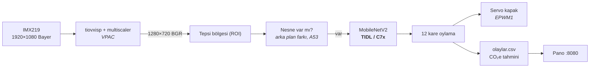

# T3 Gemstone O1 Atık Ayrıştırıcı

Raspberry Pi Camera v2 (IMX219) ile tepsiye konan atığı **plastik, organik,
kağıt/karton, cam, metal, diğer** olarak sınıflandırır. İsteğe bağlı bir
servo kapağı atığı doğru kutuya yönlendirir. Her karar kaydedilir ve doğru
ayrıştırmanın önlediği sera gazı **kg CO₂e** olarak tahmin edilip tarayıcı
panosunda gösterilir.

İklim değişikliği bağlantısı: depolama alanına giden organik atık metan
üretir, geri dönüşmeyen plastik/metal/cam yeniden üretim enerjisi ister.
Kaynağında doğru ayrıştırma ikisini de azaltır. Proje bu etkiyi sayarak
görünür kılar.

## Nasıl çalışır?



1. **Varlık algılama.** Sınıflandırıcıda "boş" sınıfı yok. Bu yüzden tepsi
   boşken arka plan öğrenilir ve fark büyüyünce "nesne var" denir.
2. **Yerleşme.** Atık konduktan sonra birkaç kare beklenir, el kadrajdan çıksın.
3. **Oylama.** 12 karenin çoğunluğu alınır. Güven ya da uyum düşükse karar
   `emin_degil` olur, kutuya yönlendirilmez.
4. **Kayıt.** `data/olaylar.csv` dosyasına zaman, sınıf, güven, tahmini kütle ve CO₂e yazılır.
   Uygulama yeniden başlayınca toplamlar buradan okunur.

## Veri ve model

Varsayılan veri kümesi [RealWaste](https://archive.ics.uci.edu/dataset/908/realwaste)'tir
(4.752 foto). Dokuz sınıfı altı kutuya eşlenir.

> [!WARNING]
> Lisans çelişkili: UCI sayfası CC BY 4.0 diyor, veri kümesinin kendi README'si
> **CC BY-NC-SA 4.0**. Kısıtlayıcı olanı esas alın: ticari kullanım yok, bu
> veriyle eğitilen model aynı lisansla paylaşılır.

Eşleme:

| Kutu | RealWaste sınıfları |
|---|---|
| plastik | Plastic |
| organik | Food Organics, Vegetation |
| kagit | Paper, Cardboard |
| cam | Glass |
| metal | Metal |
| diger | Miscellaneous Trash, Textile Trash |

`prepare_dataset.py` klasör adına bakarak eşler. Bu yüzden TrashNet ya da
Kaggle "Garbage Classification" gibi `<sınıf>/<foto>` yapısındaki başka
kümeler de `--src` ile eklenebilir. **En büyük kazanç kendi fotoğraflarınızdan
gelir.** Gerçek tepside IMX219 ile çekilen fotoğrafları `kendi/plastik/`,
`kendi/organik/` gibi klasörlere koyup `--src kendi` ile ekleyin.

### Eğitim (x86 bilgisayar, GPU önerilir)

```bash
cd training
pip install -r requirements.txt
curl -LO https://archive.ics.uci.edu/static/public/908/realwaste.zip && unzip -q realwaste.zip
python3 prepare_dataset.py --src realwaste-main/RealWaste --out dataset
python3 train.py --data dataset --out ../models/waste_mnv2 --epochs 20
```

Çıktı: `models/waste_mnv2/model.onnx` ve `labels.txt`. Ağ girdisi RGB 0–255
float, NCHW 1×3×224×224. Normalizasyon grafiğin içindedir.

İlk eğitimin sonuçları (RealWaste, 20 epoch, Quadro P4000'de ~7 dk, CPU'da
ONNX, TIDL derlemesinden önce): ayrı tutulan **test** kümesinde %93,9.
Sınıflar: cam %97,6 · organik %97,6 · metal %97,5 · kağıt %95,8 · diğer %92,6 ·
**plastik %84,8**. Plastik çoğunlukla metal ile karışıyor. Gerçek tepsiden
çekilen plastik fotoğrafları en çok bu sınıfa yarar. 8-bit TIDL nicemlemesi
sonrasında doğruluğu kartta yeniden ölçün.

### C7x için derleme (TIDL)

`edgeai-tidl-tools` sürümü kartın Processor SDK'sı ile **aynı** olmalıdır
(SDK 11.00 → `11_00_xx_xx`).

```bash
git clone -b 11_00_08_00 https://github.com/TexasInstruments/edgeai-tidl-tools
cd edgeai-tidl-tools && export SOC=am67a && source ./setup.sh
export TIDL_TOOLS_PATH=$PWD/tools/AM67A/tidl_tools LD_LIBRARY_PATH=$PWD/tools/AM67A/tidl_tools
cd <bu depo>/training
python3 compile_tidl.py --model ../models/waste_mnv2 --calib dataset/val
```

`artifacts/` klasörü yoksa uygulama CPU'da çalışır. Bu yavaştır ama bağlantıları denemek için yeterlidir.

## Kart kurulumu

Ubuntu **22.04** imajı gerekir: `t3-gem-o1-edgeai` paketinin onnxruntime_tidl
wheel'i Python 3.10 içindir.

```bash
sudo apt update && sudo apt install t3-gem-o1-edgeai python3-yaml
```

`/boot/uEnv.txt` içindeki overlay satırı:

```text
overlays=k3-am67a-t3-gem-o1-csi0-imx219.dtbo k3-am67a-t3-gem-o1-edgeai-apps.dtbo k3-am67a-t3-gem-o1-pwm-epwm1-gpio6-gpio13.dtbo
```

Servo kullanmıyorsanız PWM overlay'i gerekmez.

```bash
git clone <bu depo> ~/gem-waste-sorter          # modeli models/waste_mnv2/ altına kopyalayın
cd ~/gem-waste-sorter && sudo ./start.sh
```

Açılışta **tepsi boş olmalı**, çünkü ilk 30 karede arka plan öğrenilir. Pano
şu adreslerden açılır: `http://192.168.7.2:8080/` (USB kablosu) ya da
`http://<wlan0>:8080/`.

Otomatik başlatma:

```bash
sudo cp systemd/gem-waste-sorter.service /etc/systemd/system/
sudo systemctl enable --now gem-waste-sorter
```

## Donanım

| Parça | Bağlantı |
|---|---|
| Raspberry Pi Camera v2 (IMX219) | **CSI0**. Kart açıkken takıp çıkarmayın. |
| Ayırma kapağı servosu (isteğe bağlı) | Sinyal **pin 31** (GPIO6, EPWM1 kanal 0), + harici 5 V, GND ortak |
| Aydınlatma | Sabit beyaz LED önerilir. Arka plan farkı ve renkler ışığa duyarlıdır. |

Kamerayı tepsiye yukarıdan, sabit bakacak şekilde bağlayın. `configs/atik.yaml`
içindeki `roi` değeri tepsinin kadrajdaki yeridir.

## Yapılandırma

Tüm ayarlar `configs/atik.yaml` dosyasındadır: kamera kaynağı (`imx219`,
`usb:/dev/videoN`, `file:video.mp4`), ROI, varlık eşikleri, oylama ve kutu
tanımları. Kutuların her biri servo açısını, tek parça için ortalama kütleyi
ve **önlenen emisyon faktörünü** taşır.

> [!IMPORTANT]
> `mass_kg` ve `co2_kg_per_kg` değerleri yer tutucu niteliğinde
> yaklaşık değerlerdir. Rapor ya da sunumdan önce kullandığınız kaynağa göre
> güncelleyin ve kaynağı belirtin (ör. US EPA WARM, IPCC 2006 Atık Kılavuzu,
> DEFRA dönüşüm faktörleri).

## Testler

```bash
pip install pytest pyyaml numpy opencv-python-headless
python3 -m pytest -q tests
```

## Depo yapısı

```
app/            main.py (döngü), camera, presence, classifier, decision, climate, sorter, web + dashboard.html
configs/        atik.yaml
training/       prepare_dataset.py, train.py, compile_tidl.py
systemd/        gem-waste-sorter.service
tests/          karar, CO2 defteri ve veri eşleme testleri
models/, data/  git dışı: model dosyaları ve olay kaydı
```

## Lisans ve atıflar

Kamera hattı ve servo sürücüsü [t3gemstone/examples](https://github.com/t3gemstone/examples)
ile [object-tracker-o1](https://github.com/t3gemstone/object-tracker-o1)
örneklerinden uyarlanmıştır. RealWaste: S. Single, S. Iranmanesh, R. Raad,
*RealWaste: A Novel Real-Life Data Set for Landfill Waste Classification Using
Deep Learning*, Information 2023, 14(12), 633 (veri kümesi README'sine göre CC BY-NC-SA 4.0).
